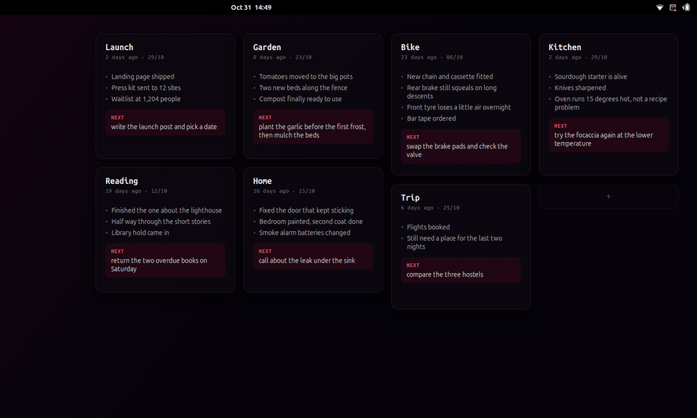

<h1 align="center">Mural</h1>

<p align="center">Notes on your GNOME desktop that snap to a grid and always stay tidy.</p>

<p align="center">
  <a href="https://github.com/vinicsperes/mural/actions/workflows/ci.yml"></a>
  
  
</p>

<p align="center">
  
</p>

Mural puts small cards on your desktop: above the wallpaper, below your windows.
Pick one up and the grid appears, with a slot showing where it will land while
its neighbours slide out of the way. Let go and it clicks into place. There is no
way to leave a card crooked, overlapping or floating loose.

Each note is a plain JSON file, so anything that can write a file can put a note
on your desktop.

## Features

- **Drag** cards around. They always land on the grid, and the rest make room
- **Resize** from either bottom corner, in whole grid steps
- **Write in place**: the card grows as you type, pushing its neighbours along
- **Works over your windows**: one shortcut brings the notes forward to jot
  something down or rearrange them, and Esc sends them back
- **Plain files**: edit, add or delete a file and the desktop follows right away
- **Plays nicely with desktop icons**: empty space still belongs to them
- English and Portuguese, following your session language

## Install

Requires GNOME Shell 50 on Wayland, plus `make` and `glib-compile-schemas`.

```sh
git clone https://github.com/vinicsperes/mural.git
cd mural
make install
```

Log out and back in, then turn it on:

```sh
gnome-extensions enable mural@vinicsperes
```

To remove it, run `gnome-extensions disable mural@vinicsperes` and `make uninstall`.
Your notes stay where they are.

## Using it

| Action | How |
| --- | --- |
| New note | `Shift` `Super` `N`, or the **+** slot on the board |
| Bring notes in front of your windows | `Shift` `Super` `M` |
| Move a note | Drag it |
| Resize a note | Drag a bottom corner |
| Edit a note | Double click it |
| Delete a note | **×** in its corner, twice. It goes to the trash |

Shortcuts can be changed with `gsettings` under
`org.gnome.shell.extensions.mural`, using the extension's `schemas` folder.

While writing:

| Key | Does |
| --- | --- |
| `Enter` | Next line, or a new bullet |
| `Enter` on an empty bullet | Moves on to the next step |
| `Backspace` on an empty line | Removes it |
| `Tab`, `Up`, `Down` | Move between lines |
| `Esc`, `Ctrl` `Enter` or a click outside | Finish and save |

## Note files

Notes live in `~/.local/share/mural`, one `.json` file each:

```json
{
  "title": "Launch",
  "date": "2026-10-29",
  "items": ["Landing page shipped", "Waitlist at 1,204 people"],
  "next": "write the launch post and pick a date"
}
```

Every field is optional. `date` shows up as "2 days ago", and `next` gets the
highlighted box at the bottom. Mural adds a `grid` field with the position, and
keeps any other fields you add, so your own tools can store data alongside.

A file that can't be read gets a card saying so and is never overwritten.

## Privacy

Notes are stored as plain text and never leave your computer: Mural makes no
network connections. They do show on your desktop, including while sharing your
screen, so keep passwords and the like somewhere else. Notes are hidden while the
screen is locked.

## Development

```sh
make test   # the grid and file format rules, needs Node
make e2e    # real drags and typing in a headless GNOME Shell
```

The end-to-end tests run a private GNOME Shell with its own data and settings, so
they are safe to run from the session you are working in.

## License

[MIT](LICENSE)
